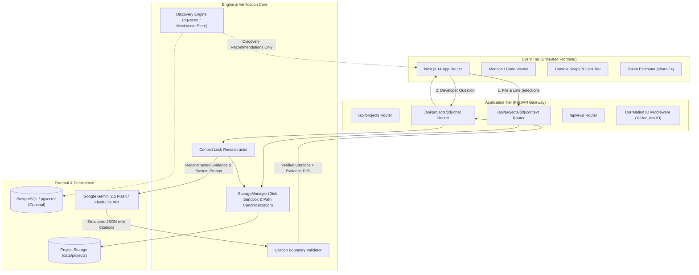
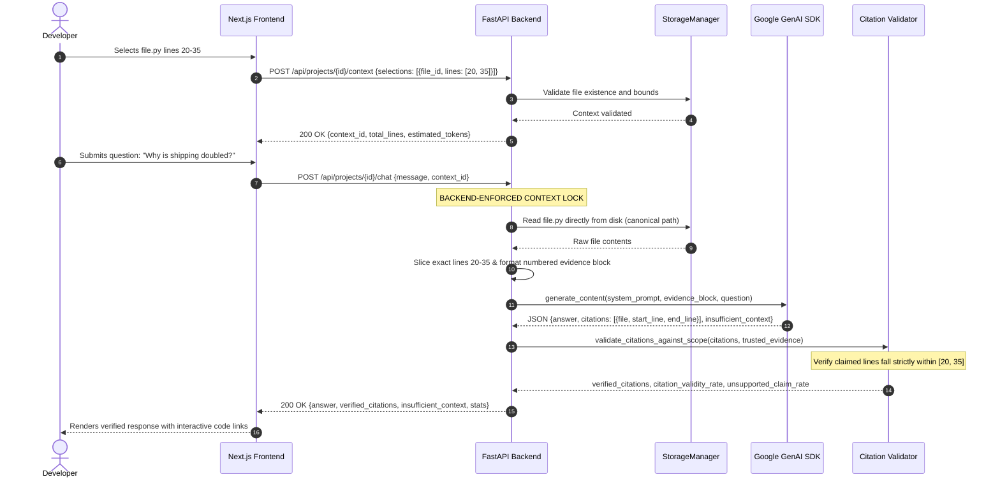

# ContextControl System Architecture

ContextControl is a developer tool and AI governance system designed to ensure that code-assistance LLMs generate answers based exclusively on developer-selected source code lines.

---

## 1. High-Level Architecture

The system decouples **context selection** from **LLM inference**, establishing the FastAPI backend as an authoritative trust boundary. The browser is treated as an untrusted client that can only request file identifiers and line indices, while the backend reconstructs, canonicalizes, formats, and validates source evidence.



---

## 2. The Context Lock Enforcement Lifecycle

The sequence diagram below shows how an inference request travels through the system. At no point does the browser transmit raw source code to the model.



---

## 3. Three-Tier Security Boundary

```mermaid
flowchart LR
    subgraph Zone1 ["Zone 1: Untrusted Client"]
        direction TB
        Browser["User Browser"]
        SelectionPayload["{file_id, lines: [10, 25]}"]
        QuestionPayload["Developer Prompt"]
    end

    subgraph Zone2 ["Zone 2: Authoritative Trust Boundary (FastAPI)"]
        direction TB
        PathGuard["Path Canonicalization & Sandbox Check"]
        DiskReader["Authoritative Disk Reader"]
        EvidenceFormatter["Evidence Block Formatter"]
        CitationChecker["Citation Range Boundary Verifier"]
    end

    subgraph Zone3 ["Zone 3: Model Boundary"]
        direction TB
        GenAI["Gemini API (Zero Data Retention Mode)"]
        StructuredOutput["Enforced JSON Schema (Citations + Context Flags)"]
    end

    Zone1 -->|Untrusted metadata only| Zone2
    Zone2 -->|Authoritative evidence prompt| Zone3
    Zone3 -->|Structured JSON response| Zone2
    Zone2 -->|Verified sanitized output| Zone1
```



### Boundary Guarantees
1. **No Client-Side Injected Code**: If a user modifies their browser DOM or API payload to submit fabricated source code, the backend completely ignores it. The backend only accepts `file_id` and line tuples `[start, end]`, fetching the ground-truth text from disk.
2. **Path Traversal Defense**: All file access undergoes resolution via `os.path.realpath` and assertion against `project_dir.resolve()`. Absolute paths, `../`, and Windows drive traversal attempts are rejected.
3. **Symlink and ZIP Bomb Defense**: During archive extraction, symlinks are detected and skipped; extracted bytes are counted against max limits; and directory depth is constrained.
4. **Citation Range Containment**: The Citation Validator compares every citation emitted by the model against the trusted evidence metadata slice. If the model cites line 42 when only lines 20–35 were in scope, the citation is flagged as `unverified` and penalized.

---

## 4. Key Subsystem Details

### 4.1 Frontend Architecture (`frontend/src/`)
- **Framework**: Next.js 14 with App Router, TypeScript, and Tailwind CSS.
- **State Management**: React state with persistent session preservation and real-time token estimation.
- **Context Scope & Lock Bar**: Docked HUD providing file count, line count, character count, and token preview (`ceil(chars / 4)`).
- **Context Preview Modal**: Allows developers to inspect the exact prompt structure sent to the LLM before dispatching queries.
- **Error Boundaries & Degradation**: Clear visual badges when offline or unconfigured; gracefully falls back to deterministic mock endpoints.

### 4.2 Backend Architecture (`backend/app/`)
- **Framework**: FastAPI with Pydantic v2 schemas and Uvicorn ASGI server.
- **Correlation ID Middleware**: Assigns or propagates an `X-Request-ID` across every HTTP request and log entry.
- **Leak-Proof Error Handler**: Intercepts unhandled exceptions, logs internal stack traces with correlation IDs, and returns sanitized RFC 7807 problem details to the client.
- **Configuration Validator**: `validate_startup_config()` checks model availability, storage directories, and database parameters at boot.

### 4.3 Storage & File Management (`app/file_manager.py`, `app/storage.py`)
- **Storage Strategy**: Local filesystem storage sandbox (`data/projects/{project_id}/files/`).
- **File Metadata DB**: Local metadata persistence (`data/projects/metadata.json`) with atomic writes via temporary files.
- **Deletion Lifecycle**: Supports complete project workspace cleanup with recursive directory deletion while maintaining decoupled index deletion.

### 4.4 Model Orchestration & Prompt Guardrails (`app/gemini_service.py`)
- **SDK**: Official Google Gen AI SDK (`google-genai`).
- **Structured Outputs**: Instructs Gemini to adhere to a strict JSON response schema:
  ```json
  {
    "answer": "string",
    "citations": [
      {
        "file": "order_calculator.py",
        "start_line": 20,
        "end_line": 35,
        "snippet": "optional quoted source"
      }
    ],
    "insufficient_context": false,
    "missing_context": []
  }
  ```
- **Context Evidence Framing**: Source lines are wrapped in unique evidence block delimiters (`--- EVIDENCE ITEM ---`) with explicit 1-based line numbering.

### 4.5 Discovery Engine (`app/vector_service.py`)
- **Strict Recommendation Boundary**: Semantic search results are treated exclusively as **suggestions**.
- **No Automatic Inclusion**: Discovered snippets are never automatically injected into the LLM context. The human developer must explicitly approve any recommended file or line range into the Context Lock.
- **Pluggable Vector Store**: Supports PostgreSQL + `pgvector` for scalable production deployments, and provides a deterministic in-memory `MockVectorStore` for offline tests and zero-dependency operation.

